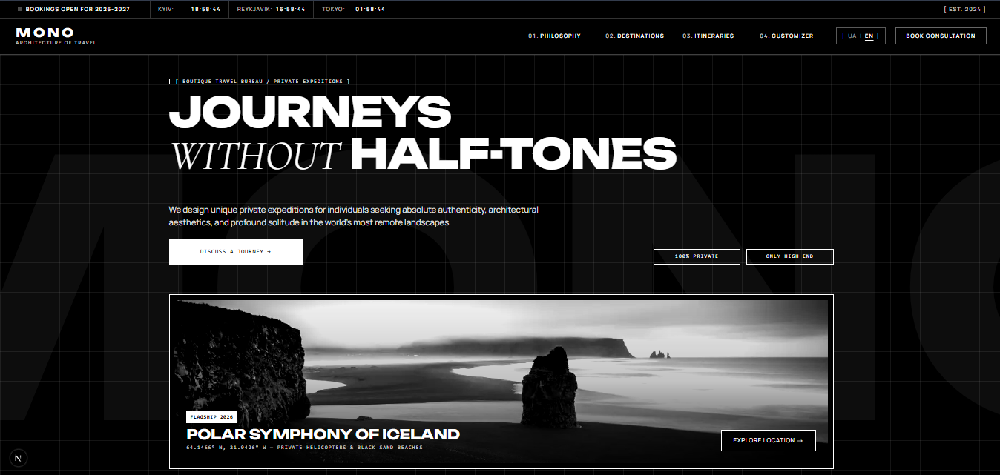

# MONO TRAVEL — Bespoke Monochrome Expeditions

Editorial Swiss-grid landing page, interactive expedition customizer, and installable Progressive Web App (PWA) for private monochrome expeditions. Built with a strict black-and-white aesthetic, zero-shift bilingual switching (`UA` / `EN`), React 19 Server Actions, and native offline support.

**Live Demo:** [mono-travel.vercel.app](https://mono-travel.vercel.app)

## Tech Stack

- **Framework:** Next.js 16 (App Router) & React 19 (`useActionState`, Server Actions)
- **Language:** TypeScript (strict mode)
- **Styling:** Tailwind CSS v4 (Swiss-grid layout, custom range inputs, `tabular-nums`, iOS safe-area insets, layout-shift-free bilingual typography)
- **PWA & Offline:** Native Web App Manifest (`app/manifest.ts`), custom Service Worker (`public/sw.js`), Sharp-generated maskable & Apple touch icons, localized `/offline` fallback
- **Icons:** Lucide React
- **Deployment:** Vercel

## Key Features

- **Editorial Swiss-Grid Design:** High-contrast monochrome interface (`#000` / `#FFF`) with `1px` structural borders, display typography, and responsive breakpoints down to `320px`.
- **Installable PWA & Offline Resilience:** Native `manifest.ts`, custom Service Worker caching strategy, and a dedicated monochrome `/offline` fallback route for standalone mobile and desktop installation.
- **iOS Standalone & Mobile UX Polish:** Full `viewport-fit=cover` and `env(safe-area-inset-*)` support for notched iOS devices, header-aware mobile anchor navigation, and scroll-locked modal sheets.
- **Zero-Shift Bilingual Support (`UA` / `EN`):** Instant client-side language switching without vertical layout shifts.
- **Interactive Expedition Customizer:** Real-time calculation of expedition duration, group size, and curated add-ons with direct payload transfer into the booking modal.
- **Booking Modal & Server Actions:** Validated expedition request submission via React 19 `useActionState` and Next.js Server Actions with optional webhook dispatch (`EXPEDITION_WEBHOOK_URL`).
- **Custom System Boundaries:** Dedicated monochrome `404` (`app/not-found.tsx`) and localized Error Boundary (`app/error.tsx`).
